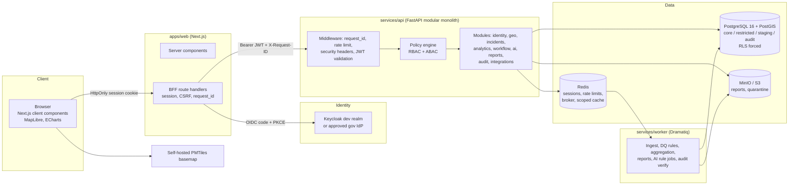
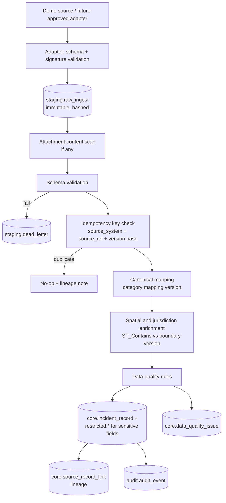

# CRIMEMAP Architecture

> Phase 0 design. Nothing described here is implemented yet. Decisions are recorded in
> [decision-log.md](decision-log.md); references such as (ADR-002) point there.

## 1. Purpose in one paragraph

CRIMEMAP lets authorised police users look at **synthetic** (later: officially authorised) incident
records on a map, analyse them by place and time, and move an evidence-backed observation through a
governed workflow: analyst review → supervisor decision → operational action → outcome review. It never
creates or edits FIRs, never ranks people, and every view, change, and export is authorised by the
backend and audited.

## 2. Requirements summary

**Functional:** Home Map, PY Dashboard (with seven Trends boards), Analytics Workbench (seven sections),
Review Queue (six queues), Reports (PDF/CSV/map image); operational records; data-quality, review,
action and outcome workflows; explainable AI assistance; pluggable ingestion with a demo adapter.

**Non-functional (key):**

| Area | Target / rule |
|---|---|
| Security | Deny-by-default RBAC + ABAC on backend and database; OIDC + MFA; OWASP ASVS-aligned |
| Privacy | Data minimisation, role-based masking, small-cell suppression (ADR-012), precision reduction (ADR-020) |
| Auditability | Every authorisation decision for sensitive resources, view, change, export, AI interaction audited; append-only (ADR-008) |
| Performance | Map filter p95 < 500 ms at 200k records (ADR-017, proposed) |
| Availability | Demo: single host. Production target to be set with hosting owner |
| Accessibility | WCAG 2.2 AA |
| Portability | Container-based; deployable on-premise; no proprietary cloud lock-in |
| Data residency | No third-party calls carrying police data (tiles self-hosted, LLM disabled) |

## 3. Component diagram

## 4. Request lifecycle (authorised map query)

1. Browser calls `GET /bff/map/features?...` with the session cookie.
2. BFF loads the session, refreshes the access token if needed, adds `X-Request-ID`, forwards to
   `GET /api/v1/map/features`.
3. FastAPI middleware validates the JWT (issuer, audience, expiry, MFA claim for the role), applies the
   rate limit, and builds a `Subject` (user, roles, scopes, classification ceiling).
4. The route's declared permission (`map.features.read`) is checked by the policy engine; scope is
   intersected with the requested filters (a request for an out-of-scope station is **denied**, not
   silently narrowed, and audited as a denial).
5. A transaction starts; `SET LOCAL app.*` scope settings are applied; RLS filters rows.
6. The geo module runs a bounded PostGIS query in the region's projected CRS (ADR-005), applies
   precision reduction (ADR-020) and small-cell suppression (ADR-012).
7. An audit event (`MAP_QUERY`, filters, result count, decision) is written in the same transaction as
   the read, so a successful response always has its audit record (fail-closed). **Denials and errors**
   are audited in a separate, independent transaction, so a rolled-back request can never erase the
   record of the attempt.
8. The response includes a `meta` block: filters applied, record count, excluded count and reasons,
   data freshness, method, caveats, classification label.

## 5. Data flow — ingestion

## 6. Workflow state machines

**Pattern review:** `DRAFT → SUBMITTED → (SUPERVISOR) APPROVED | RETURNED | REJECTED`; `RETURNED →
SUBMITTED`. Creation requires the evidence fields listed in the specification (pattern type, geometry,
category, period, baseline, record count, DQ summary, narrative, evidence snapshot, next step).

**Operational action:** `PROPOSED → APPROVED | RETURNED | REJECTED`; `RETURNED → PROPOSED` (after
revision); `REJECTED` is terminal; `APPROVED → IN_PROGRESS → COMPLETED → OUTCOME_DUE →
OUTCOME_REVIEWED`. Only roles with `action.approve` within the action's territory can approve, return,
or reject; the proposer can never decide their own action (separation of duties).

**AI insight:** `PENDING → VALIDATED | DISMISSED`. A validated insight can only inform a pattern review an
analyst creates; it never becomes an action directly. AI cannot create actions, export, or modify records.

**Data-quality issue:** `OPEN → ASSIGNED → RESOLVED | ACCEPTED_AS_IS`; corrections to source data become
correction requests, never direct edits of source records.

Every transition is a service method that checks permission, validates preconditions, writes the new
state and an audit event in one transaction.

## 7. Module responsibilities

| Module | Owns | Notes |
|---|---|---|
| identity | users, roles, permissions, scopes | mirrors IdP identities; roles granted inside CRIMEMAP |
| geo | org units, boundaries (versioned), grids, projections | region CRS helpers |
| incidents | incident records, locations, categories, notes, operational records | read-mostly; no FIR create/edit |
| analytics | aggregates, trends, comparisons, DQ metrics | always returns `meta`; enforces suppression |
| workflow | pattern reviews, actions, outcomes, review queue | state machines |
| ai | rule/statistical insights, model registry, kill switch | no write tools |
| reports | export requests, rendering, watermark, signed URLs | re-auth for high-risk scopes |
| audit | audit events, verification | append-only |
| integrations | source systems, adapters, health, reconciliation | demo adapter only |

## 8. Environments

| Environment | Data | Identity | Banner |
|---|---|---|---|
| DEMO (local / hackathon) | synthetic only | Keycloak demo realm | DEMO / SYNTHETIC DATA |
| SANDBOX | synthetic only | approved test IdP | SANDBOX |
| PRODUCTION | not available — requires approvals listed in [integration-contracts.md](integration-contracts.md) | government IdP | PRODUCTION |

The environment is set by configuration and shown in the UI shell; production mode refuses to start if
demo seed data or the mock IdP is detected.

## 9. Technology choices and substitutions

The specification's default stack is adopted without substitution: Next.js 15+ / React 19 /
TypeScript strict, Tailwind + customised shadcn/Radix, TanStack Query, Zustand (UI state only), React
Hook Form + Zod, Apache ECharts, MapLibre GL JS, Turf.js (presentation only), FastAPI + Pydantic v2,
SQLAlchemy 2 async + Alembic, PostgreSQL 16 + PostGIS 3.4+, Redis 7, Dramatiq, MinIO, OpenTelemetry,
Prometheus, Grafana, NGINX (TLS termination, TLS 1.3), OpenTofu, GitHub Actions. Analytics: pandas,
GeoPandas, Shapely, PyProj, NumPy, SciPy, statsmodels, scikit-learn, and PySAL where appropriate, run in
the worker or API analytics module — never in the browser. **pgvector is not used** unless an approved
copilot later needs document retrieval (specification: "only if"). Exact package versions are pinned at
scaffold time (Phase 1) after checking current stable releases.

## 10. Risks

| Risk | Likelihood | Impact | Mitigation |
|---|---|---|---|
| Scope too large for hackathon timeline | High | High | Thin vertical slices; security foundations first; phase gates |
| 8 GB RAM limits local stack | Medium | Medium | Compose profiles, host-run web app, mock IdP fallback (ADR-018) |
| RLS mis-configuration (owner bypass) | Medium | High | Non-owner role, `FORCE RLS`, automated cross-scope tests |
| Inference of individuals from aggregates | Medium | High | Small-cell suppression, precision reduction |
| Demo mistaken for real data or official boundaries | Medium | High | Persistent banners, synthetic labels on boundaries and exports |
| AI output over-trusted | Medium | High | Evidence cards, mandatory validation, no AI write paths |
